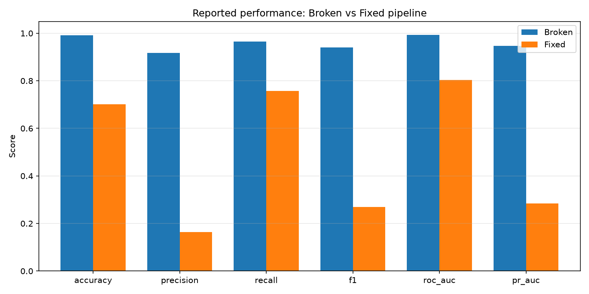

# Debugging a Broken ML Pipeline


A hands-on debugging project: a customer-churn pipeline that looks excellent (**99.1% accuracy, F1 0.94**) but is full of
deliberate flaws. This repository contains the **original broken code**, the **fixed code**, a **step-by-step ablation**
that shows how the score changes after each fix, and a **PDF report** explaining every issue, why it matters and how it was detected.

---

## Table of Contents

1. [Objective](#objective)
2. [Key Results](#key-results)
3. [The Nine Flaws](#the-nine-flaws)
4. [Project Structure](#project-structure)
5. [Architecture](#architecture)
6. [How It Works](#how-it-works)
7. [Getting Started](#getting-started)
8. [Step-by-Step Ablation](#step-by-step-ablation)
9. [Report](#report)
10. [Limitations](#limitations)
11. [Tech Stack](#tech-stack)
12. [Author](#author)

---

## Objective

Build (or receive) an ML pipeline containing at least six deliberate flaws, then:

- find every flaw,
- fix it,
- show how the reported performance changes,
- document each issue: **what it is, why it matters, how it was detected**.

All six categories from the brief are covered: **data leakage, wrong train/test splitting, unscaled features,
ignored label imbalance, wrong metric choice and a data-ordering bug**, plus three more.

## Key Results

Test-set results on the same synthetic dataset (Logistic Regression in both pipelines):

| Metric | Broken | Fixed |
|---|---|---|
| Accuracy | 0.9909 | 0.7015 |
| Precision | 0.9198 | 0.1644 |
| Recall | 0.9551 | 0.7568 |
| F1 | 0.9371 | 0.2702 |
| ROC-AUC | 0.9937 | 0.8037 |
| PR-AUC | 0.9482 | 0.2847 |

> **The fixed score is lower, and that is the correct, honest score.** The broken pipeline's numbers came mostly from one leaked
> feature and from using accuracy on a 6% positive-rate problem. Removing the leak alone drops F1 from 0.94 to 0.01.
>
> The broken pipeline's numbers can differ in the third decimal place across machines (unscaled features make the solver numerically
> sensitive, which is itself one of the flaws). The fixed pipeline gives identical numbers everywhere.



## The Nine Flaws

| # | Flaw | Category | Fix |
|---|---|---|---|
| 1 | `cancellation_request_logged` is only known after a customer churns | Target leakage | Detected via correlation scan (r = 0.92), dropped |
| 2 | 2,000 duplicate rows end up in both train and test | Data leakage | `drop_duplicates()` before splitting |
| 3 | Imputer fitted on the whole dataset before the split | Preprocessing leakage | Imputer inside a `Pipeline` |
| 4 | Time-ordered data split randomly | Data-ordering bug | Chronological split (past = train, future = test) |
| 5 | No stratification; validation ignores time order | Wrong splitting | Time-based split + `TimeSeriesSplit` CV |
| 6 | Unscaled features (income ~60,000 vs calls ~2); warnings hidden | Unscaled features | `StandardScaler` inside the `Pipeline` |
| 7 | 93.7% / 6.3% class imbalance ignored | Label imbalance | `class_weight='balanced'` |
| 8 | Hyperparameter `C` chosen on the test set | Evaluation protocol | `GridSearchCV` on training data only |
| 9 | Accuracy used as the headline metric | Wrong metric | Precision, recall, F1, ROC-AUC, PR-AUC |

Each flaw is marked with a `FLAW n` comment in `broken_pipeline.py` and a matching `FIX n` comment in `fixed_pipeline.py`.

## Project Structure

```
Debugging-Broken-ML-Pipeline/
├── README.md                  # Project documentation (this file)
├── requirements.txt           # Python dependencies
├── .gitignore                 # Ignores venv, caches, editor files
│
├── data_generator.py          # Synthetic churn dataset with planted flaw conditions
├── utils.py                   # Metrics, printing and leakage / data-quality diagnostics
├── broken_pipeline.py         # ORIGINAL pipeline with 9 deliberate flaws
├── fixed_pipeline.py          # CORRECTED pipeline
├── compare_results.py         # Runs both pipelines, saves comparison table and chart
├── ablation_study.py          # Applies the fixes one at a time (cumulative)
│
├── assets/
│   ├── preview.png            # Project preview image (1280x640, GitHub social preview size)
│   └── architecture.png       # Architecture diagram of the broken and fixed pipelines
│
├── results/
│   ├── comparison.csv         # Broken vs fixed metrics
│   ├── comparison.png         # Bar chart of the comparison
│   └── ablation.csv           # Metrics after each cumulative fix
│
└── docs/
    └── Debugging_Broken_ML_Pipeline_Report.pdf   # Full report: issue, impact, detection, fix
```

## Architecture


Both pipelines read the same synthetic dataset from `data_generator.py` and share the helpers in `utils.py`. `compare_results.py` and `ablation_study.py` run them and write the tables and charts into `results/`, which feed the report in `docs/`.

## How It Works

**Dataset (`data_generator.py`).** 22,000 synthetic telecom-style customers ordered by sign-up time, with a fixed seed (42):

- ~6.3% churn (imbalanced)
- a leaky feature (`cancellation_request_logged`), 2,000 duplicate rows and 3,910 missing values
- features on very different scales
- a churn pattern that drifts over time

**Broken pipeline (`broken_pipeline.py`).** Keeps the leaky feature and duplicates, imputes before splitting, shuffles
time-ordered data, trains an unscaled Logistic Regression without class weights, picks `C` on the test set and reports accuracy.

**Fixed pipeline (`fixed_pipeline.py`).**

1. Prints data-quality diagnostics (duplicates, missing values, class balance)
2. Removes duplicates, then splits chronologically (80% past / 20% future)
3. Detects and drops leaky features using the training data only
4. Builds `Pipeline(SimpleImputer -> StandardScaler -> LogisticRegression(class_weight='balanced'))`
5. Tunes `C` with `GridSearchCV` and `TimeSeriesSplit(5)`, scored by average precision
6. Evaluates on the test set exactly once

## Getting Started

**Prerequisites:** Python 3.10 or newer (developed and tested on Python 3.12).

```bash
# 1. Clone the repository
git clone https://github.com/<your-username>/Debugging-Broken-ML-Pipeline.git
cd Debugging-Broken-ML-Pipeline

# 2. Create and activate a virtual environment
python -m venv venv
venv\Scripts\activate          # Windows
# source venv/bin/activate     # Linux / macOS

# 3. Install dependencies
pip install -r requirements.txt
```

**Run:**

```bash
python broken_pipeline.py     # original (broken) pipeline
python fixed_pipeline.py      # corrected pipeline
python compare_results.py     # side-by-side table + chart  -> results/
python ablation_study.py      # effect of each fix           -> results/ablation.csv
```

**Example output (`fixed_pipeline.py`):**

```
--- Data quality diagnostics ---
Rows                : 22000
Duplicate rows      : 2000
Missing values      : 3910
Leaky features detected: ['cancellation_request_logged']
Best C (from CV)       : 0.1

FIXED PIPELINE - full metrics
accuracy  : 0.7015
precision : 0.1644
recall    : 0.7568
f1        : 0.2702
roc_auc   : 0.8037
pr_auc    : 0.2847
Confusion matrix -> TN=2585  FP=1123  FN=71  TP=221
```

## Step-by-Step Ablation

`ablation_study.py` applies the fixes cumulatively so the effect of each step is visible (effects interact, so these are not isolated per-flaw contributions):

| Step | Accuracy | Precision | Recall | F1 | ROC-AUC | PR-AUC |
|---|---|---|---|---|---|---|
| 0. Broken pipeline | 0.9909 | 0.9198 | 0.9551 | 0.9371 | 0.9937 | 0.9482 |
| 1. + remove leaky feature | 0.9295 | 1.0000 | 0.0064 | 0.0127 | 0.7760 | 0.2303 |
| 2. + remove duplicates | 0.9412 | 0.5000 | 0.0043 | 0.0084 | 0.7568 | 0.1711 |
| 3. + impute/scale in Pipeline | 0.9412 | 0.0000 | 0.0000 | 0.0000 | 0.7583 | 0.1716 |
| 4. + class_weight='balanced' | 0.7052 | 0.1295 | 0.7021 | 0.2187 | 0.7590 | 0.1716 |
| 5. + chronological split | 0.7042 | 0.1663 | 0.7603 | 0.2729 | 0.8025 | 0.2811 |
| 6. + CV tuning (= fixed pipeline) | 0.7015 | 0.1644 | 0.7568 | 0.2702 | 0.8037 | 0.2847 |

Takeaways:

- **Step 1:** nearly all of the original performance came from the leaked feature.
- **Steps 1-3:** accuracy stays near 94% (the always-predict-no-churn baseline) while almost no churners are found. This is why accuracy is the wrong metric here.
- **Step 4:** class weighting is what makes the model detect churners at all.
- **Steps 5-6:** make the estimate trustworthy rather than higher.

## Report

The full write-up is in [`docs/Debugging_Broken_ML_Pipeline_Report.pdf`](docs/Debugging_Broken_ML_Pipeline_Report.pdf). For every flaw it gives:

- **Issue:** what was wrong
- **Why it matters:** the effect on the model and the reported score
- **How it was detected:** the specific check or evidence
- **Fix:** what was changed

## Limitations

- **Synthetic data.** The flaws were planted, so effect sizes on real data will differ. The value is in the detection method.
- **Small effects for some flaws.** Duplicates and median-imputer leakage barely move a linear model's score; they usually matter more for flexible models (random forest, boosting), which was not tested here.
- **Single seed and split.** No confidence intervals were computed.
- **Threshold fixed at 0.5.** Precision is low (0.16); threshold tuning on a separate validation set is a natural next step.

## Tech Stack

Python, scikit-learn, pandas, NumPy, Matplotlib.

## Author

**Muhammad Faizan Farooq**
Machine Learning & AI Engineer
GitHub: [faizanjutt473](https://github.com/faizanjutt473)
